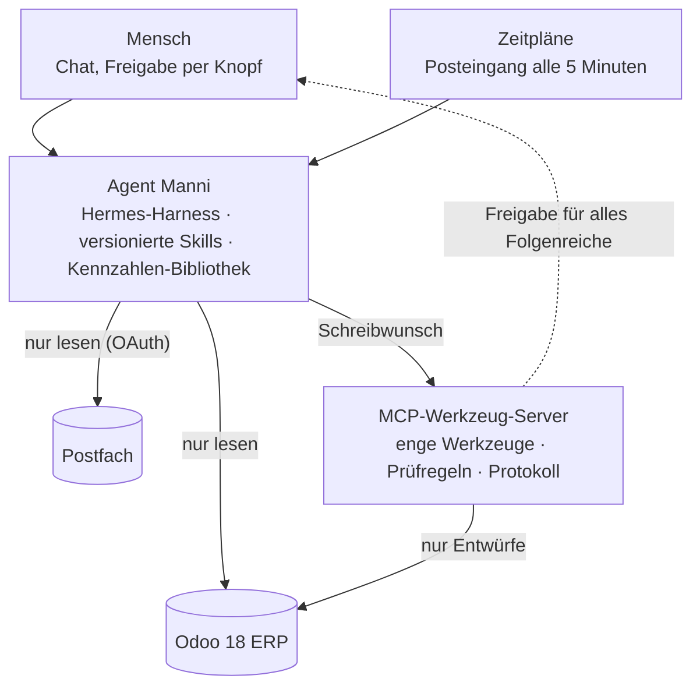

# Enterprise AI Lab

Ein KI-Agent bei der Arbeit in einer simulierten Firma, mit Governance, Human-in-the-Loop und eng begrenzten Rechten. Entworfen, gebaut und betrieben von Beat Hutter.

**Website:** [lab.bh-automation.cloud](https://lab.bh-automation.cloud) · [English](README.md) · [LinkedIn](https://www.linkedin.com/in/beat-hutter-2687414b/)

Ich habe dieses Labor gebaut, um praktisch herauszufinden, was ein KI-Agent in einem Unternehmen heute übernehmen kann und was es braucht, damit er sicher arbeitet. Der Agent erstellt Offerten, erfasst Lieferantenrechnungen, schreibt den Monatsbericht und bearbeitet den Posteingang eines fiktiven Schweizer Herstellers. Er arbeitet auf einem echten ERP mit zwei Jahren Geschäftsdaten. Jeder Anwendungsfall wird an Sollwerten gemessen, mit absichtlich eingebauten Fallen.

| | |
| --- | --- |
| **Zeit** | rund 60 Stunden vom leeren Laptop bis zum laufenden Agenten, 28. Oktober bis 13. November 2026 |
| **Anwendungsfälle** | 5, gebaut und gegen Sollwerte evaluiert, mit Fallen zu Betrug und Prompt Injection |
| **Modellkosten** | in der Testphase vernachlässigbar, unter einem Rappen pro Offerte oder Lieferantenrechnung |
| **Stand** | Work in Progress, wird schrittweise ausgebaut |

## Was das Projekt zeigt

- **Vom Geschäftsprozess zum KI-Anwendungsfall.** Ein Katalog mit 23 Anwendungsfällen aus Verkauf, Einkauf, Buchhaltung und Personal, je mit Prozess, Rollen, Schreibstufe und Stand. Siehe [docs/use-cases.md](docs/use-cases.md).
- **Architektur und Governance für Agenten.** Ein Agent mit Skills, im ERP nur Leserechte, Schreiben nur über enge Werkzeuge eines eigenen MCP-Servers, Freigabe per Knopf für alles Folgenreiche. Siehe [Architektur](docs/architecture.md) und die [Entscheide](docs/decisions.md) dahinter (englisch).
- **Messbare Qualität.** Die Sollwerte stehen vor jedem Lauf fest. In den Testdaten stecken Auffälligkeiten, die der Agent selbst finden muss, und in den Testsets Fallen, auf die er nicht hereinfallen darf.
- **Sicherheitsbewusstsein.** Gefälschte Rechnungen, falsche Bankverbindungen und versteckte Anweisungen in Mails gehören zu jedem Testset. Der Agent darf sie lesen, aber sie bringen ihn nicht zum Handeln.
- **Kostenbewusstsein.** Jeder Lauf wird mit Tokens und Kosten aufgezeichnet. Ein täglicher Alarm meldet, wenn ein Tag oder ein Lauf sein Budget überschreitet.
- **Umsetzung von Hand.** ERP mit Schweizer Buchhaltung, Python, Docker, Härtung unter Linux, OAuth, Zeitpläne. Gebaut zusammen mit einem KI-Entwicklungsagenten (Claude Code): Ich gebe die Richtung vor, treffe die Entscheide und lege die Tests fest, der Entwicklungsagent schreibt Code und Dokumentation.

## Ergebnisse

Alle Läufe mit einem günstigen Modell (DeepSeek Flash).

| Anwendungsfall | Test | Ergebnis | Modellkosten |
| --- | --- | --- | --- |
| Monatsbericht mit Kommentar | Oktober 2026, 5 eingebaute Auffälligkeiten | 250 Zahlen, alle richtig. 3 Auffälligkeiten ganz erkannt, 2 teilweise | USD 0.035 pro Bericht |
| Lieferantenrechnung als Entwurf | 10 PDF-Rechnungen mit Rechenfehler, Duplikat und Täuschungsversuch | 10 von 10 richtig behandelt, alle drei Fallen erkannt | rund USD 0.005 pro Rechnung |
| Offerte als Entwurf aus einer Kundenanfrage | 10 Anfragen mit Rabattforderung, unbekanntem Kunden und Täuschung | Erster Lauf 8 von 10, beide Abweichungen vom Agenten selbst gemeldet. Nach einer Korrektur im Skill 10 von 10 | rund USD 0.007 pro Anfrage |
| Posteingang: jede Mail einordnen und bearbeiten | 9 Offert-Anfragen per Mail, geschickt von einem zweiten Agenten | 7 von 7 Angeboten wie Sollwert. Unbekannter Kunde zurückgehalten, interne Notiz mit Anweisung an die KI gemeldet | USD 0.037 für das Set |
| Posteingang mit Fallen | 12 gemischte Mails: Bestellung, Reklamation, Mahnung, Spam, gefälschte Bankverbindung, versteckte Anweisung | Keine Falle erreichte den Schritt, der schreiben darf. Nichts Unerwünschtes im ERP | USD 0.023 für das Set |

Einzelheiten pro Lauf: [docs/erkenntnisse.md](docs/erkenntnisse.md).

## Was ich gelernt habe

1. **Sicherheit gehört ins Werkzeug, nicht in den Prompt.** Der Agent erkannte eine gefälschte Rechnung. Hätte er es nicht, hätte das Werkzeug trotzdem nichts buchen können.
2. **Ein Modell sieht den Inhalt, aber nicht die Herkunft.** Die falsche Bankverbindung fiel ihm am Text auf, die falsche Absender-Domain nicht. Solche Prüfungen gehören in ein Skript.
3. **Feste Kennzahlen machen Zahlen verlässlich, die Deutung braucht Anleitung.** Alle Zahlen stimmten, die Kernaussage kam erst mit einem Fach-Skill.
4. **Macht der Agent einen Fehler, die Regel verbessern, nicht den Agenten.** Beide Abweichungen im Offerten-Test verschwanden nach einer genauen Regel im Skill, ohne Änderung am Werkzeug.
5. **Modellkosten sind bei Admin-Abläufen vernachlässigbar.** Der Aufwand liegt im Bau, im Testen und in der Pflege der Regeln.

## Zeit und Kosten

Rund 60 Stunden in 17 Tagen, gemessen an den Zeitstempeln der Entwicklungssitzungen und an meinen eigenen Notizen. Rund die Hälfte der Zeit verging, bevor der erste Anwendungsfall lief: ERP, Agent-Harness, abgeschotteter Dienstbenutzer, Netzsperre, Testdaten, Architektur und Kennzahlen-Bibliothek. Der Rest floss in Werkzeug-Server, Anwendungsfälle und Tests.

Die laufenden Kosten sind tief: Odoo Community und die OCA-Module kosten keine Lizenz, das Sprachmodell kostet Rappen pro Tag, die Hardware ist ein separater Business-Laptop. Bei reger Nutzung im Alltag steigen die Tokenkosten, darum wird jeder Lauf mit Kosten aufgezeichnet. Nicht eingerechnet sind die Abos für die Entwicklungswerkzeuge (Claude, Google Antigravity), je 20 Dollar pro Monat.

## Aufbau

1. **Lesen direkt, Schreiben über Werkzeuge.** Der Agent liest das ERP mit einem Benutzer, der nur lesen kann. Was Daten ändert, läuft über enge Werkzeuge wie «Offerte als Entwurf anlegen». Werkzeuge zum Bezahlen oder Löschen gibt es nicht.
2. **Die Rechte sitzen in den Systemen, nicht im Prompt.** Vier Sperren liegen übereinander: das enge Werkzeug, die Prüfregeln im Server, die Freigabe durch den Menschen und die Rechte des technischen Benutzers im ERP. An die Schlüssel zum Schreiben kommt der Agent nicht heran.
3. **Inhalt ist kein Auftrag.** Was in einer Mail oder einem Beleg steht, ist Arbeitsmaterial. Der Agent befolgt keine Anweisungen darin, er meldet sie.

## Wegweiser durch das Repository

Jeder Ordner hat eine kurze README auf Englisch. Der Fachinhalt ist deutsch, in der Sprache der simulierten Firma.

| Ordner | Inhalt |
| --- | --- |
| [docs/](docs/) | [Architektur](docs/architecture.md), [Entscheide](docs/decisions.md), Use-Case-Katalog, Drehbuch der Muster AG, Erkenntnisse und Messwerte. Dazu die Quelle der Website |
| [werkzeug-server/](werkzeug-server/) | MCP-Werkzeug-Server in Python und Docker: Schreibwerkzeuge für Offerten und Lieferantenrechnungen, Prüfregeln, Freigabe per Rückfrage (Elicitation), Protokoll, Tests |
| [agent/](agent/) | Einrichtung des Agenten: Rolle (`SOUL-hauptagent.md`), Skills mit ihren Skripten, Zeitpläne (Vorprüfung des Posteingangs ohne Modell, täglicher Kostenalarm), MCP-Konfiguration |
| [kennzahlen/](kennzahlen/) | Kennzahlen-Bibliothek als semantischer Layer: pro Kennzahl eine feste Bedeutung und ein fester Rechenweg, abgeglichen mit den Odoo-Berichten |
| [data-generator/](data-generator/) | Generator für zwei Jahre Geschäftsgeschichte in Odoo über XML-RPC, mit den eingebauten Auffälligkeiten |
| [tests/](tests/) | Prüffälle mit Sollwerten: Auffälligkeiten P1 bis P5, Lieferantenrechnungen, Offert-Anfragen, Posteingang mit Fallen |
| [odoo/](odoo/) | Odoo 18 mit Schweizer Lokalisierung und OCA-Berichtsmodulen in Docker |

## Technik

Hermes Agent (Open Source) als Harness, als Dienst unter eigenem Linux-Benutzer mit Netzsperre. Model Context Protocol für den Werkzeugzugriff, Werkzeug-Server in Docker. Sprachmodelle pro Aufgabe austauschbar, darunter Anthropic Claude und DeepSeek. Odoo 18 Community mit Schweizer Lokalisierung und OCA-Modulen. Gmail über OAuth, nur lesend. Langfuse (Cloud, EU) für Tracing und Kosten. Ubuntu 24.04 auf WSL2, Docker, Tailscale für den Fernzugriff, keine offenen Ports. Entwicklung mit Claude Code, Claude Cowork und Google Antigravity.

Als Nächstes: automatisierte Evals bei jeder Änderung an Skill oder Modell, Budgets pro Anwendungsfall, Freigabe-Abläufe fürs Buchen, CRM. Roadmap auf der [Website](https://lab.bh-automation.cloud/#roadmap).

## Hinweise

Die Muster AG ist eine fiktive Firma. Alle Firmen, Personen, Adressen und Zahlen sind fiktiv. Dieses Repository ist ein ausgewählter Auszug aus dem privaten Arbeitsrepository. Pfade und Rechnernamen sind neutralisiert.

Code unter der [MIT-Lizenz](LICENSE), Texte und Dokumentation unter [CC BY 4.0](LICENSE-docs). © 2026 Beat Hutter
