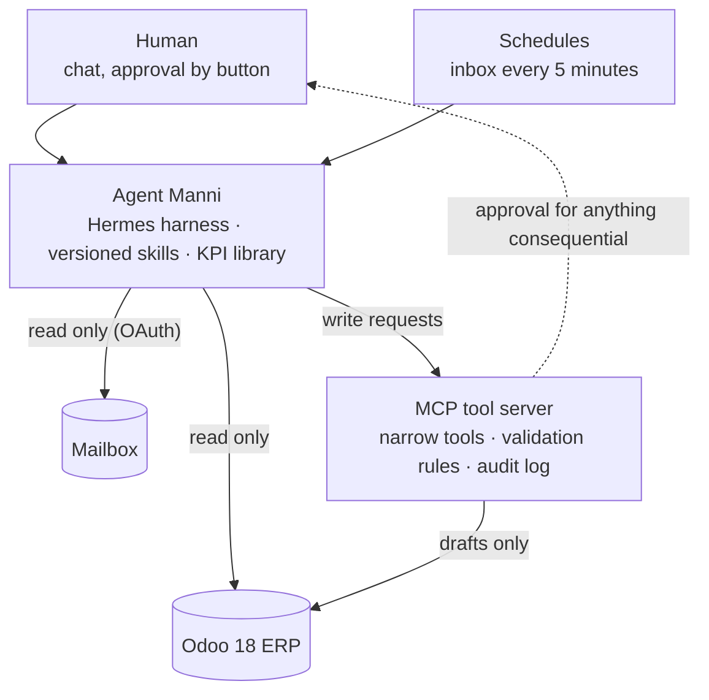

# Enterprise AI Lab

An AI agent at work in a simulated company, with governance, human-in-the-loop and tightly scoped permissions. Designed, built and operated by Beat Hutter.

**Website:** [lab.bh-automation.cloud](https://lab.bh-automation.cloud) · [Deutsch](README.de.md) · [LinkedIn](https://www.linkedin.com/in/beat-hutter-2687414b/)

I built this lab to find out, hands-on, what an AI agent can take over in a company today and what it takes to let it work safely. The agent handles quotes, supplier invoices, the monthly report and the inbox of a fictitious Swiss manufacturer. It runs on a real ERP with two years of business data, and every use case is measured against expected results with deliberate traps built in.

| | |
| --- | --- |
| **Time** | about 60 hours from an empty laptop to a running agent, 28 October to 13 November 2026 |
| **Use cases** | 5, built and evaluated against expected values, including fraud and prompt-injection traps |
| **Model cost** | negligible during testing, below CHF 0.01 per quote or supplier invoice |
| **Status** | work in progress, extended step by step |

## What this project shows

- **From business process to AI use case.** A catalogue of 23 use cases across sales, purchasing, accounting and HR, each with process, roles, write level and status. See [docs/use-cases.md](docs/use-cases.md).
- **Architecture and governance for agents.** One agent with skills, read-only access to the ERP, writing only through narrow tools on a dedicated MCP server, approval by button for anything consequential. See [architecture](docs/architecture.md) and the [decisions](docs/decisions.md) behind it.
- **Measurable quality.** Expected values are fixed before each run. The test data contains anomalies the agent has to find on its own, and the test sets contain traps it must not fall for.
- **Security awareness.** Forged invoices, fake bank details and hidden instructions in emails are part of every test set. The agent may read them, but they cannot make it act.
- **Cost awareness.** Every run is traced with tokens and cost. A daily alert reports when a day or a run exceeds its budget.
- **Hands-on delivery.** ERP setup with Swiss accounting, Python, Docker, Linux hardening, OAuth, scheduled jobs. Built together with an AI coding agent (Claude Code): I set the direction, take the decisions and define the tests, the coding agent writes code and documentation.

## Results

All runs with a low-cost model (DeepSeek Flash).

| Use case | Test | Result | Model cost |
| --- | --- | --- | --- |
| Monthly report with commentary | October 2026, 5 built-in anomalies | 250 figures, all correct. 3 anomalies fully found, 2 partly | USD 0.035 per report |
| Supplier invoice as draft | 10 PDF invoices incl. calculation error, duplicate and a deception attempt | 10 of 10 handled correctly, all three traps recognised | about USD 0.005 per invoice |
| Quote as draft from a customer request | 10 requests incl. a discount demand, an unknown customer and a deception | First run 8 of 10, both deviations flagged by the agent itself. After one skill fix 10 of 10 | about USD 0.007 per request |
| Inbox: classify every email and act | 9 quote requests by email, sent by a second agent | 7 of 7 quotes as expected. Unknown customer held back, internal note with an instruction to the AI escalated | USD 0.037 for the set |
| Inbox with traps | 12 mixed emails: order, complaint, dunning letter, spam, forged bank details, hidden instruction | No trap reached the step that may write. Nothing unwanted in the ERP | USD 0.023 for the set |

Details per run: [docs/erkenntnisse.md](docs/erkenntnisse.md) (German).

## What I learned so far

1. **Security belongs in the tool, not in the prompt.** The agent spotted a forged invoice. Had it not, the tool still could not have posted anything.
2. **A model sees content, not origin.** It caught fake bank details by their wording, but missed the wrong sender domain. Such checks belong in a script.
3. **Fixed KPI definitions make numbers reliable. Interpretation still needs guidance.** All figures were correct, yet the key message only came with a domain skill.
4. **When the agent fails, fix the rule, not the agent.** Both deviations in the quote test disappeared after one precise rule in the skill, with no change to the tool.
5. **Model costs are negligible for admin work.** The real effort lies in building, testing and maintaining the rules.

## Time and cost

About 60 hours over 17 days, measured from timestamps of the coding sessions and my own notes. About half of the time passed before the first use case ran: ERP, agent harness, isolated service user, network lock, test data, architecture and KPI library. The rest went into the tool server, the use cases and their tests.

Running costs are low: Odoo Community and the OCA modules are free of licence fees, the language model costs cents per day, the hardware is a separate business laptop. With heavy daily use, token costs go up, which is why every run is recorded with its cost. Not included are the subscriptions for the development tools (Claude, Google Antigravity), 20 dollars per month each.

## How it is built

1. **Reading is direct, writing goes through tools.** The agent reads the ERP with a user that can only read. Anything that changes data runs through narrow tools such as "create quote draft". Tools for paying or deleting do not exist.
2. **Permissions live in the systems, not in the prompt.** Four locks stack up: the narrow tool, validation rules in the server, human approval, and the permissions of the technical user in the ERP. The keys for writing are out of the agent's reach.
3. **Content is not a command.** Whatever an email or document says is material to work on. The agent does not follow instructions inside it, it reports them.

## Repository guide

Each folder has a short README in English. Domain content is in German, the language of the simulated company.

| Folder | Content |
| --- | --- |
| [docs/](docs/) | [Architecture](docs/architecture.md), [decisions](docs/decisions.md), use case catalogue, scenario of Muster AG, lessons and measurements. Also the source of the website |
| [werkzeug-server/](werkzeug-server/) | MCP tool server in Python and Docker: write tools for quotes and supplier invoices, validation rules, approval by elicitation, audit log, tests |
| [agent/](agent/) | Agent setup: persona (`SOUL-hauptagent.md`), skills with their scripts, scheduled jobs (inbox pre-check without a model, daily cost alert), MCP configuration |
| [kennzahlen/](kennzahlen/) | KPI library as a semantic layer: one fixed definition and calculation per figure, reconciled against Odoo reports |
| [data-generator/](data-generator/) | Generator for two years of business history in Odoo via XML-RPC, with the built-in anomalies |
| [tests/](tests/) | Test cases with expected values: anomalies P1 to P5, supplier invoices, quote requests, inbox set with traps |
| [odoo/](odoo/) | Odoo 18 with Swiss localisation and OCA reporting modules in Docker |

Glossary: Werkzeug-Server = tool server · Kennzahl = KPI · Drehbuch = scenario · Prüffall = test case · Sollwert = expected value · Offerte = quote · Entwurf = draft · Lieferantenrechnung = supplier invoice · Posteingang = inbox · Freigabe = approval · Manni = name of the agent.

## Technology

Hermes Agent (open source) as harness, running as a service under its own Linux user with a network lock. Model Context Protocol for tool access, tool server in Docker. Language models swappable per task, including Anthropic Claude and DeepSeek. Odoo 18 Community with Swiss localisation and OCA modules. Gmail via OAuth, read-only. Langfuse (cloud, EU) for tracing and cost. Ubuntu 24.04 on WSL2, Docker, Tailscale for remote access, no open ports. Development with Claude Code, Claude Cowork and Google Antigravity.

Next steps: automated evals on every skill or model change, budgets per use case, approval workflows for postings, CRM. Roadmap on the [website](https://lab.bh-automation.cloud/en/#roadmap).

## Notes

Muster AG is a fictitious company. All companies, people, addresses and figures are fictitious. This repository is a curated extract of the private working repository. Paths and host names are neutralised.

Code under the [MIT licence](LICENSE), texts and documentation under [CC BY 4.0](LICENSE-docs). © 2026 Beat Hutter
